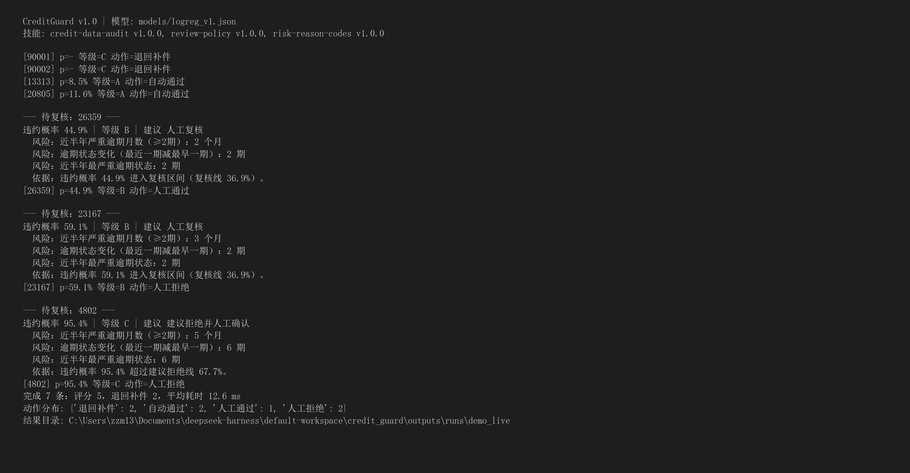
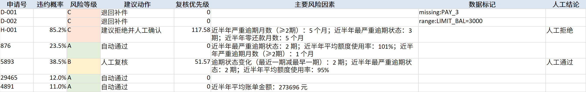
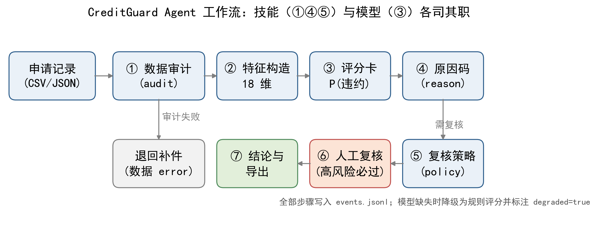
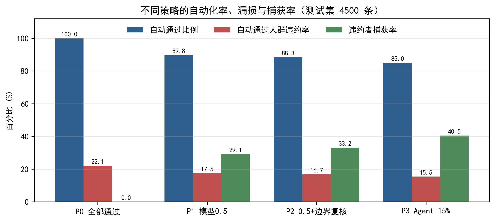

# CreditGuard · 信贷初审风险复核 Agent

[](https://github.com/xiaohong156/028123264--/actions/workflows/ci.yml)
[](https://codespaces.new/xiaohong156/028123264--)
[](LICENSE)
[](requirements.txt)

《机器学习》课程期末项目。把**逻辑回归评分卡**嵌入一个可运行、可审计的 Agent 工作流：
数据审计先拦脏数据，再给出违约概率、原因码与 A/B/C 分级建议；所有"建议拒绝"都必须人工确认。

> 对应课程模块「信用风险或异常识别」（逻辑回归、类别不平衡、ROC/AUC）。
> 报告： [`docs/assets/report.pdf`](docs/assets/report.pdf) ｜ 演示脚本： [`docs/demo.md`](docs/demo.md) ｜ 提交清单： [`docs/SUBMISSION.md`](docs/SUBMISSION.md) ｜ 在线展示页： https://xiaohong156.github.io/028123264--/

## 三种演示方式

### ① 命令行一键演示（30 秒，不用训练、不用下载数据）

```bash
git clone https://github.com/xiaohong156/028123264--.git && cd 028123264--
pip install -r requirements.txt
python scripts/demo_offline.py
```

用 `data/samples/` 里的真实申请（另注入两条脏数据）跑完整链路，输出复核摘要、Excel 清单和逐步审计日志：



### ② 网页原型（可交互单笔试算）

```bash
python web/server.py          # 打开 http://127.0.0.1:8000
```

提供低风险 / 高风险 / 脏数据三个预设，实时显示概率、原因码、等级与建议动作。
在 GitHub Codespaces 中运行会自动转发端口，等于一个在线原型。

### ③ 看导出的复核清单

`outputs/runs/offline_demo/review_queue.xlsx`：等级着色、原因码、人工结论，汇总页用公式自动统计。



## 实测结果（测试集 4500 条）

| 策略 | 自动通过 | 自动通过人群违约率 | 违约者捕获率 | 好客户被拒 |
| --- | --- | --- | --- | --- |
| P0 全部通过 | 100% | 22.1% | 0% | 0% |
| P1 模型 0.5 阈值自动决策 | 89.8% | 17.5% | 29.1% | 4.85% |
| P2 0.5 + 边界复核 | 88.3% | 16.7% | 33.2% | 3.82% |
| **P3 Agent 15% 分级** | **85.0%** | **15.5%** | **40.5%** | **1.83%** |

评分卡：AUC 0.755，PR-AUC 0.505（随机基线 0.221），Brier 0.142；单条端到端 12.9 ms。
注入 225 条脏数据后，审计技能拦截 75.1%、标记 24.9%，未审计时 100% 静默进入模型。





## 目录结构

```
.
├── src/creditguard/
│   ├── agent.py            # 状态机、人工复核、事件日志
│   ├── cli.py              # demo / batch / skills
│   ├── schema.py           # 字段、取值范围、中文标签
│   ├── ml/                 # 数据、特征、评分卡、指标
│   ├── skills/             # 3 个 Agent Skills（SKILL.md + skill.py）
│   └── tools/io.py         # CSV/JSON/Excel 读写
├── web/                    # 标准库 Web 原型（无额外依赖）
├── scripts/                # 下载、训练、评估、图表、演示
├── tests/                  # 16 个单元测试
├── tools/skill_lint.py     # 复用开源校验器
├── vendor/anthropic-skills # Apache-2.0 技能与校验脚本（含 commit 记录）
├── docs/                   # GitHub Pages 展示页 + 截图 + 演示脚本
├── data/                   # 原始数据、处理后数据、样例
├── models/                 # 评分卡 JSON
└── report/                 # 报告 docx / pdf
```

## 完整复现

```bash
python scripts/download_data.py       # UCI 350，约 3 MB
python scripts/train.py               # 训练评分卡（约 20 秒）
python scripts/evaluate.py --n 4500   # 基线 / 容量扫描 / 审计消融
python -m pytest tests -q             # 16 个单元测试
python tools/skill_lint.py            # 3 个技能规范校验
python scripts/make_figures.py        # 报告图表
```

模型与处理后数据已随仓库提供，跳过前两步也能直接运行演示和评估。

## 复用的开源组件

| 组件 | 版本/提交 | 许可证 | 用途 |
| --- | --- | --- | --- |
| UCI Default of Credit Card Clients | dataset 350 | CC BY 4.0 | 训练与评估数据 |
| anthropics/skills · skill-creator | commit `2c5958e` | Apache-2.0 | SKILL.md 规范与 `quick_validate.py` 校验 |
| scikit-learn | 0.24.1 | BSD-3-Clause | 标准化、逻辑回归、指标 |
| pandas / numpy | 1.2.4 / 1.20.1 | BSD-3-Clause | 数据处理 |
| openpyxl | 3.1.5 | MIT | 复核清单导出 |
| PyYAML | 5.4.1 | MIT | 解析 SKILL.md frontmatter |

详见 [`THIRD_PARTY.md`](THIRD_PARTY.md) 与 [`vendor/anthropic-skills/VENDOR.md`](vendor/anthropic-skills/VENDOR.md)。

## 数据与隐私

- 数据来自 UCI 公开脱敏数据集，不含真实身份信息；仓库不保存任何密钥。
- 推理全部在本地完成，不调用外部服务。
- 模型输出仅用于辅助复核，**不构成自动拒贷决定**。

## 已知限制

- 特征只有 6 个月账单/还款历史，AUC 0.75 左右，缺少外部征信与收入信息。
- 数据来自 2005 年中国台湾地区，跨地区、跨时期使用需要重新校准。
- 未做公平性审计（性别、教育、婚姻可能是代理变量）。
- 策略阈值按 15% 复核容量设定，产能变化时需按验证集重新计算。

## 引用

- Yeh, I. C., & Lien, C. H. (2009). *Expert Systems with Applications*, 36(2), 2473–2480.
- Anthropic. *Agent Skills*（Apache-2.0）. https://github.com/anthropics/skills
